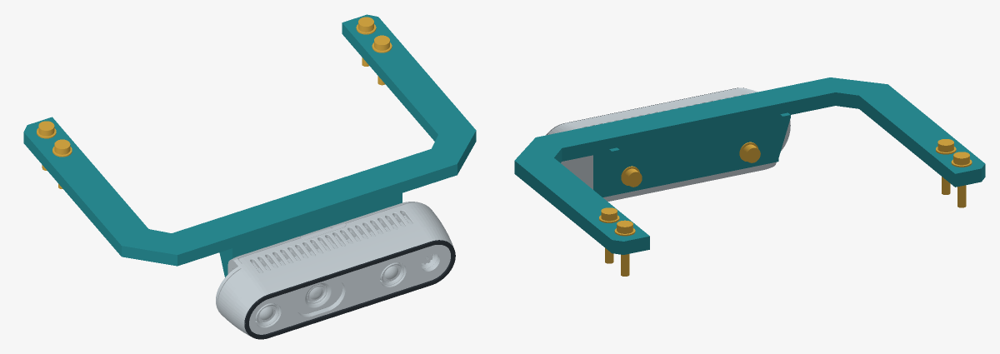

# D435 전방 6점 체결 마운트

청록색이 출력물이고 금색은 체결 위치를 표시한 볼트입니다. 왼쪽은 렌즈 쪽, 오른쪽은 카메라 후면입니다. [전체 조립 모델](assembled-waffle.png)

## 출력

[Bambu Studio 프로젝트](D435_A1_PLA.3mf)를 열거나 [출력용 STL](D435_A1_PLA.stl)을 mm 단위로 불러옵니다. 넓은 U자 면이 베드에 닿고 카메라 체결 플랜지가 위를 향하는 방향으로 저장했습니다. 장착할 때는 뒤집어 플랜지가 아래를 향하게 합니다.

| 항목 | 값 |
|---|---|
| 프린터·소재 | Bambu Lab A1, 0.4 mm 노즐, Generic PLA, Textured PEI |
| 공정 | Standard 속도, 첫 층 0.20 mm, 이후 0.28 mm, 2벽, 15% 인필, 서포트 끔 |
| 가로 × 앞뒤 × 높이 | 142 × 91 × 25 mm |
| Bambu Studio 슬라이스 | 90층, 16.97 g, 준비 포함 약 41분 |

## 조립 순서

[와플 상판 평면도와 A–D 체결 단면](D435-deck-top-view.png)

1. **와플 상판 홀을 먼저 확인합니다.** 원본 Waffle Pi CAD에서 선택한 네 중심은 차축 중앙 기준 전방 12 mm와 24 mm, 좌우 각각 64 mm입니다. 같은 쪽 앞뒤 간격은 **12 mm**, 좌우 간격은 **128 mm**입니다. 실물에서 네 점의 간격, 하부 너트 접근, 기존 스페이서와 배선 위치를 확인합니다.
2. **카메라를 출력물에 먼저 체결합니다.** D435의 렌즈를 로봇 전방으로, 로고와 나사 구멍이 있는 뒷면을 수직 플랜지에 맞댑니다. 좌우 보강 리브 사이로 M3×8 두 개를 넣어 전방을 향해 조입니다. 각 나사에는 두께 0.5 mm의 평와셔를 씁니다. 플랜지 5 mm와 와셔를 통과한 공칭 물림은 **2.5 mm**입니다. 출력물 실두께와 와셔를 포함한 돌출 길이가 제조사 허용 최대 **3 mm** 이내인지 체결 전에 잽니다. 후면 두 홀의 중심 간격은 **45 mm**입니다. [RealSense D400 데이터시트, 그림 10-9](https://www.realsenseai.com/wp-content/uploads/2026/03/RealSense-D400-Series-Datasheet-Mar-2026.pdf)
3. **마운트를 와플에 네 점으로 고정합니다.** 포크의 양쪽 레일을 상판에 얹고 좌우 두 개씩, 총 네 개의 Ø3.4 mm 원형 홀에 M3 볼트와 평와셔를 넣습니다. 기존 볼트로 데크를 묶고 있는 자리라면 한 개씩 교체하고 원래의 너트·스페이서를 유지합니다. 볼트 길이는 기존 체결 두께에 레일 5 mm와 새 와셔 두께를 더해서 선정합니다. 비어 있는 관통홀에는 하부 와셔와 M3 풀림방지 너트를 씁니다. 배선 및 기판과의 여유를 확인한 뒤 네 개를 번갈아 조입니다.
4. 렌즈 앞과 USB 포트 옆을 비워 두고 케이블은 레일에 고정합니다. 실물에서 팔을 접고 펼쳤을 때 케이블 여유, 카메라 흔들림, 전방 수평을 확인합니다.

## ROS 좌표와 형상 검증

상판 기준면은 base_link에서 z=91.5 mm입니다. D435 후면 접촉면은 x=96 mm, 두 M3 축은 y=±22.5 mm, z=77.5 mm입니다. URDF의 camera_bottom_screw_frame은 기존 RealSense 좌표 규약에 따라 (106.1547, 0, 65) mm에 둡니다. 실제 고정은 후면 M3 두 개가 담당합니다. 광학 프레임의 +Z는 차체 +X입니다. 카메라 전면은 x=121.05 mm이며 Nav2 외곽의 전단은 125 mm입니다.

포크는 닫힌 단일 솔리드입니다. 원본 차체 STL과의 삼각형 간섭 검사에서 상판과의 의도된 면 접촉을 제외하기 위해 출력물을 0.01 mm 들어 올려 검사했습니다. 시제품의 강성, 체결 공차와 진동은 실물 검증 항목입니다.

[파라메트릭 원본](make_mount.py)은 Python의 numpy와 manifold3d를 사용합니다. 실행하면 출력 방향 STL, 장착 방향 STL과 체결구 시각화 메시를 각각 생성합니다. 형상을 변경하면 3MF를 다시 슬라이스합니다. 카메라 본체는 [제조사 D435 CAD 메시](https://github.com/realsenseai/realsense-ros/blob/ros2-master/realsense2_description/meshes/d435.dae)를 제조사 URDF의 축 배치로 변환한 것입니다.
