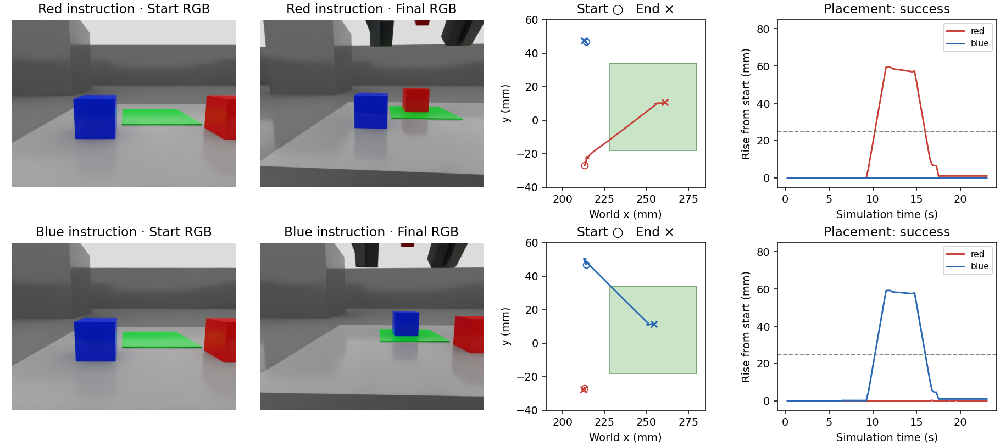

# 색상 지시로 블록을 집어 놓는 모방학습

같은 장면에서 빨간 블록과 파란 블록의 지시만 바꿔 두 번 실행한다. 정책 입력은 전방 D435의 시작 RGB, 지시문, 초기 로봇 상태다. 목표는 한 변 52 mm인 초록색 정사각형으로 고정한다. 위치 일반화는 이 작업대 위에서 처음 보는 블록 좌표로 평가한다.

## 측정 결과

RTX 5060 Laptop GPU와 Isaac Sim 6.1에서 학습용 교사 시연 **16/16회**가 성공했다. HF 시연 4개(176개 샘플)와 추가 시연 16개(1,472개 샘플)를 병합해 새 예측층을 학습했다. 보류한 배치 4개에서 빨간 블록 **4/4**, 파란 블록 **4/4**, 전체 **8/8**을 목표에 놓았다. 같은 장면·시간·구동 조건에서 기존 HF 정책으로 첫 두 보류 배치를 평가한 대조 결과는 **0/4**였다.

평가 블록과 가장 가까운 학습 블록 사이의 초기 수평 거리는 **2.58 mm**였다. 지정 블록은 **59.1–64.0 mm** 상승했고, 최종 블록 중심과 목표 중심의 수평 오차는 **1.0–11.3 mm**였다. 모든 시행에서 다른 색 블록을 들어 올린 횟수는 0이었다. 이 결과는 같은 작업대와 고정 목표에서 가까운 미학습 위치로 보간한 시험이다. [시행별 좌표·높이·안착 시간](color-heldout-8601.json)



## 재현

Isaac Sim 6.1 장면, HF OpenMANIPULATOR-X 시연, 기존 HF VLA 체크포인트는 [기본 학습 예제](README.md)에서 만든 파일을 사용한다. 로컬 캐시에 SmolVLM2가 준비된 GPU PC에서 실행한다.

```bash
cd ~/waffle_mpx/src
RUN="$HOME/waffle_mpx/learning_runs"
HF_HUB_OFFLINE=1 learning/reproduce_color_pick_place.sh ../simulation/scene.usda \
  "$RUN/hf-examples" "$RUN/waffle-hf-vla.pt" "$RUN/color-repeat-$(date +%Y%m%d-%H%M%S)"
```

출력의 `demos`에는 시연별 RGB, 상태, 행동과 물리 판정이 있다. `mixed`에는 원본 HF 시연과 성공한 색상 시연을 같은 행동 스키마로 읽는 로컬 데이터셋을 만든다. 이 디렉터리는 원본 시연과 이미지를 심볼릭 링크로 참조하므로 복사할 때 함께 보관한다. `color.npz`는 새 궤적 예측 가중치, `color.json`은 학습에 사용한 에피소드·좌표·리비전·체크섬, `heldout`은 새로운 좌표에서 실행한 결과다.

## 시연과 학습

- 교사 제어기는 훈련 장면의 선택된 블록 위치와 팔 관절 피드백으로 역기구학을 풀어 접근, 닫기, 들어올리기, 운반, 열기, 후퇴 동작을 시연한다. 블록은 8 g 자유 강체이고 양손가락과 블록 사이의 마찰로 들어 올린다. 물체 고정, 순간이동, 목표로의 스냅은 시행 초기화 후 사용하지 않는다.
- 20 mm 블록에 맞춰 모의 그리퍼에 21 × 16 × 16 mm 고마찰 라이너를 양쪽에 추가했다. PhysX에서 양쪽 프리즘 관절에 같은 목표를 전달하고 팔 구동 강성을 조정했다. 이 구성은 이 작업의 시뮬레이터 설정이다. 실제 그리퍼에서는 라이너, 파지력과 제어 이득을 따로 확인해야 한다.
- 기존 HF VLA의 SmolVLM2와 행동 헤드의 은닉층을 고정한다. 여기서 얻은 128차원 특징, 지시문에서 선택한 색상의 영상 내 중심과 크기를 사용해 92개 시점의 관절·그리퍼 목표를 출력하는 회귀층을 학습한다. 4개 HF 시연은 에피소드 길이를 정규화해 공통 동작 학습에 넣고, 로컬 색상 시연으로 시뮬레이션 보정과 위치별 궤적을 함께 학습한다. 원본 HF 저장소는 로컬에서 받은 리비전을 사용한다.
- 배치 8개에 두 지시를 적용해 16회 시연한다. 색상 시연은 실제 블록이 목표에 놓인 경우만 학습한다. 평가 때는 시뮬레이터의 물체 좌표나 교사 역기구학을 호출하지 않는다. 시작 영상에서 계획한 궤적을 관절 피드백으로 속도 제한해 4 Hz로 실행하므로 운반 중 외부에서 블록을 움직이는 조건은 별도의 작업이다.
- 학습 시드 73의 시작 x는 202–211 또는 219–228 mm, 평가 시드 8601의 x는 213–217 mm다. 두 색상의 좌우 순서를 번갈아 바꾸고 y도 무작위화한다. `audit_color_eval.py`는 체크포인트 해시, 같은 배치의 지시쌍, 실제 정착 좌표 간 최소 거리, 성공 판정의 일관성을 확인한다.
- 집기는 선택 블록이 손끝 근처에서 25 mm 이상 상승해야 한다. 놓기는 손을 뗀 뒤 블록의 전체 수평 투영이 초록 목표 안에 있고 0.5초간 안착한 경우다. 다른 블록을 들어 올리면 실패다. 세부 속도·높이 허용 오차는 [평가 기준](README.md#지시한-물체-집어-놓기-평가)에 있다.

이미 생성된 이 PC의 모델로 평가 부분만 재실행할 때는 다음 명령을 사용한다.

```bash
cd ~/waffle_mpx/src
RUN="$HOME/waffle_mpx/learning_runs"
OUT="$RUN/color-eval-$(date +%Y%m%d-%H%M%S)"
HF_HUB_OFFLINE=1 ~/isaacsim6_venv/bin/python sim/evaluate_pick_place.py \
  ../simulation/scene.usda "$RUN/waffle-color-73.npz" "$OUT" \
  --controller color --parent-vla "$RUN/waffle-hf-vla.pt" --layouts 4 --seed 8601 --decisions 92
python3 learning/audit_color_eval.py "$RUN/waffle-color-73.npz" "$OUT"
python3 learning/plot_pick_place.py "$OUT" "$OUT/paired-trial.png" --layout 0
```
